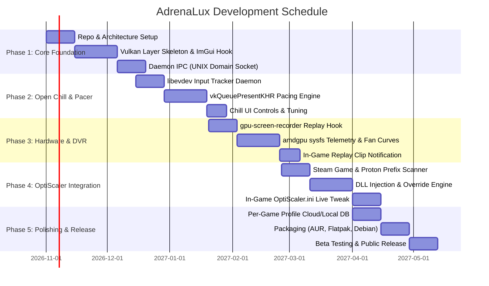

# AdrenaLux: Master Engineering Plan & Technical Specification

> **Project Goal:** Build a unified, high-performance Linux gaming overlay and management suite that brings the best of AMD Adrenalin (Unified In-Game HUD, Dynamic Frame Pacing / Radeon Chill, Instant Replay DVR, Hardware Tuning, and Automated OptiScaler / DLSS-to-FSR profiles) to the Linux gaming ecosystem.

---

## 1. Executive Summary & Problem Space

### The Problem
On Windows, AMD users enjoy **AMD Software: Adrenalin Edition** — an integrated suite providing:
1. An in-game overlay triggered via `Alt+R` / `Alt+Z`.
2. **Radeon Chill & Boost**: Dynamic, input-aware frame limiting and motion-based dynamic resolution scaling.
3. **Radeon ReLive**: Zero-friction, hardware-accelerated DVR replay buffering and clipping.
4. **Hardware Tuning**: Power limits, custom fan curves, voltage offsets, and real-time telemetry.
5. **Driver-level upscaling / mod management**: FSR toggles and game-specific profiles.

On Linux, the open-source driver stack (**Mesa RADV + Linux amdgpu**) delivers exceptional raw compute performance and stability, but the user experience is **fragmented across disconnected tools**:
* Overclocking/Fan control requires **LACT** or **CoreCtrl**.
* On-screen metrics require **MangoHud**.
* DVR clipping requires standalone **`gpu-screen-recorder`**.
* Upscaling requires manual **Gamescope** CLI flags or copying DLLs for **OptiScaler**.
* **Dynamic input-aware frame limiting (Chill)** does not exist on Linux at all — limiters are strictly static.

### The Solution: AdrenaLux
**AdrenaLux** provides a modular, daemon-driven architecture featuring:
* A **Vulkan Implicit Layer** that renders a sleek in-game overlay (Dear ImGui) directly into the game's swapchain on `Alt+R`.
* An **Open Chill engine** monitoring `evdev` input events to dynamically throttle framerates during menus/AFK and instantly ramp up upon user action.
* An **OptiScaler & Profile Manager** that identifies running Steam/Proton games, injects DLSS-to-FSR translation layers, and allows in-game configuration of upscaling and frame generation.
* An **Instant Replay Controller** backed by `gpu-screen-recorder` for hardware-accelerated clipping via an in-game hotkey.

---

## 2. System Architecture

```
+-----------------------------------------------------------------------------------+
|                              GAME PROCESS (Proton / Native)                       |
|                                                                                   |
|   +-------------------+       +-----------------------------------------------+   |
|   |    Game Engine    | ----> |              Vulkan Swapchain                 |   |
|   |  (D3D11/12/Vulkan)|       +-----------------------------------------------+   |
|   +-------------------+                               |                           |
|             |                                         v                           |
|             |                        +---------------------------------+          |
|             |                        |   AdrenaLux Vulkan Layer        |          |
|             v                        |   (VK_LAYER_ADRENALUX_overlay)  |          |
|   +-------------------+              +---------------------------------+          |
|   | OptiScaler Bridge |                               |                           |
|   | (DLSS -> FSR 3.1) |                               | ImGui Render & Frame Pacer|
|   +-------------------+                               v                           |
|                                                  Display Present                  |
+-----------------------------------------------------------------------------------+
                                         ^
                                         | Local UNIX Socket IPC
                                         v
+-----------------------------------------------------------------------------------+
|                            ADRENALUX CORE DAEMON (adrenaluxd)                     |
|                                                                                   |
|  +--------------------+   +--------------------+   +---------------------------+  |
|  |   Input Monitor    |   |   Hardware Engine  |   |    DVR Replay Engine      |  |
|  |   (libevdev Chill) |   |   (amdgpu sysfs)   |   |   (gpu-screen-recorder)   |  |
|  +--------------------+   +--------------------+   +---------------------------+  |
|                                                                                   |
|  +--------------------+   +--------------------+   +---------------------------+  |
|  |   Profile Engine   |   |  OptiScaler Bridge |   |      D-Bus / CLI API      |  |
|  | (Steam/Proton scan)|   | (DLL injection/INI)|   |   (adrenalux desktop app) |  |
|  +--------------------+   +--------------------+   +---------------------------+  |
+-----------------------------------------------------------------------------------+
```

---

## 3. Core Modules & Technical Specifications

### Module A: In-Game Overlay (`adrenalux-overlay`)
* **Technology:** C++ / Rust with Vulkan API and **Dear ImGui**.
* **Mechanism:** Registered as an implicit Vulkan layer (`~/.local/share/vulkan/implicit_layer.d/VkLayer_ADRENALUX_overlay.json`).
* **Interceptions:**
  * `vkCreateDevice` / `vkDestroyDevice`: Initialize graphics pipeline and descriptor pools.
  * `vkCreateSwapchainKHR`: Hook render targets and format specifications.
  * `vkQueuePresentKHR`: Render ImGui overlay passes on top of game frame before handoff to compositor.
* **Hotkey Handling:** Global shortcut (`Alt+R` or configurable `Alt+Z`) toggles UI focus and input capture.
* **Features:**
  * Telemetry HUD (Frametime graph, 1% lows, GPU Clock, VRAM, Hotspot Temp, Power Draw).
  * Quick Actions: Save Replay (hotkey), Toggle Chill, Upscaling Mode selector.
  * Hardware Tuning drawer (Fan profiles, Power Limit slider).

### Module B: Open Chill & Boost (`adrenalux-chill`)
* **Objective:** Deliver the power-saving and thermal benefits of AMD Radeon Chill and Boost on Linux.
* **Input Tracking:**
  * Daemon listens to `/dev/input/event*` devices using `libevdev` (mouse, keyboard, gamepad).
  * Measures idle duration $\Delta t = t_{\text{current}} - t_{\text{last\_input}}$.
* **Dynamic Frame Pacing Algorithm:**
  ```text
  If (now - last_input_time) > idle_timeout_ms:
      target_fps = lerp(target_fps, fps_idle, transition_rate)
  Else:
      target_fps = fps_active (or uncapped)

  sleep_duration = calculate_target_frame_time(target_fps) - render_time
  if sleep_duration > 0:
      clock_nanosleep(CLOCK_MONOTONIC, sleep_duration)
  ```
* **Open Boost:** Detects rapid camera sweeps ($d\theta/dt > \text{threshold}$) and signals the upscaler or Gamescope to temporarily downscale dynamic render resolution to prioritize FPS consistency.

### Module C: OptiScaler & Game Profile Engine (`adrenalux-profiles`)
* **Objective:** Enable seamless DLSS-to-FSR upscaling and frame generation in Proton titles without manual DLL tinkering.
* **Game Detection:**
  * Monitors `/proc` or queries Steam API / `libraryfolders.vdf` for active game launching (`AppId`).
  * Resolves game directory and Wine prefix path (`compatdata/<AppId>/pfx`).
* **Automated Injection:**
  * Deploys OptiScaler artifacts (`dxgi.dll`, `nvngx.dll`, `libxess.dll`) into the game binary directory.
  * Configures Wine DLL overrides automatically (`WINEDLLOVERRIDES="dxgi=n,b;nvngx=n,b"`).
* **Live In-Game Config Sync:**
  * Parses and writes `OptiScaler.ini` in real-time.
  * Allows the user to toggle FSR 3.1 Frame Gen, adjust sharpness, and change upscaling presets (Quality, Balanced, Performance) directly from the in-game overlay without restarting the game.

### Module D: Replay DVR & AMD Hardware Control (`adrenalux-sys`)
* **Instant Replay (DVR):**
  * Spawns `gpu-screen-recorder` in background replay-buffer mode using AMD VCN hardware encoding (`-c mp4 -r 60 -w screen`).
  * On hotkey / overlay trigger: Sends `SIGUSR1` to immediately dump the ring buffer into `~/Videos/Replays/` with zero CPU overhead.
  * Displays in-overlay toast notification confirming clip capture.
* **Hardware Telemetry & Tuning:**
  * Directly interfaces with `/sys/class/drm/card*/device/hwmon/hwmon*/`:
    * Edge, junction/hotspot, and VRAM temperatures.
    * Real-time power draw (`power1_average`) and power limits (`power1_cap`).
    * Fan speed (`fan1_input`) and manual PWM curve modulation (`pwm1`).
  * Integrates with or leverages `amdgpu.ppfeaturemask` overdrive endpoints for safe clock/voltage offsets.

---

## 4. Multi-Month Implementation Roadmap



### Month 1: Architecture Foundation & Overlay Hook
- [ ] Initialize repository structure (`crates/` or `src/` modular layout).
- [ ] Build minimal Vulkan Implicit Layer intercepting `vkCreateDevice` and `vkQueuePresentKHR`.
- [ ] Integrate Dear ImGui inside the Vulkan rendering pipeline.
- [ ] Implement hotkey toggle (`Alt+R`) and basic metrics display (FPS, frametime).
- [ ] Design UNIX domain socket protocol for communication between game overlay and `adrenaluxd`.

### Month 2: Open Chill (Input-Aware Frame Limiting)
- [ ] Develop `adrenalux-chill` input event listener using `libevdev`.
- [ ] Implement high-precision frame pacer using `clock_nanosleep(CLOCK_MONOTONIC)` in `vkQueuePresentKHR`.
- [ ] Implement dynamic hysteresis: smoothly ramp down FPS after $N$ seconds of inactivity, instantly ramp up to native refresh rate on any key/mouse/controller input.
- [ ] Benchmark power consumption on RDNA 4 (RX 9070 XT) across menus vs. gameplay.

### Month 3: Instant Replay DVR & AMD Hardware Controls
- [ ] Build background replay manager around `gpu-screen-recorder`.
- [ ] Add overlay trigger and hotkey (`Alt+F10` / custom) to fire `SIGUSR1` clip save.
- [ ] Read GPU junction/VRAM temperatures, clocks, and power draw from `hwmon`.
- [ ] Implement fan curve editor and power limit slider in overlay.

### Month 4: OptiScaler & Proton Game Profiles
- [ ] Implement Steam library discovery (`~/.local/share/Steam` and external library folders).
- [ ] Build automated OptiScaler injection module for detected Proton prefixes.
- [ ] Create parser and writer for `OptiScaler.ini`.
- [ ] Add in-game overlay panel for adjusting upscaling quality, sharpness, and frame generation on the fly.

### Month 5: Optimization, Packaging & Community Launch
- [ ] Implement per-game profile persistence (storing custom Chill limits, fan curves, and upscaler choices per Steam AppId).
- [ ] Test compatibility across major compositors (KDE KWin Wayland, GNOME Mutter, Hyprland, Gamescope).
- [ ] Package for Arch Linux (AUR), Fedora (COPR), and Debian/Ubuntu.
- [ ] Publish documentation, installation guide, and demonstration video.

---

## 5. Technology Stack Decisions

| Component | Language / Framework | Justification |
| :--- | :--- | :--- |
| **Vulkan Layer** | Rust (`cdylib`) | Low overhead, zero runtime pause/GC, pure C ABI compatibility, memory safety. |
| **Core Daemon (`adrenaluxd`)** | Rust (Tokio) | Concurrency safety without data races, fast async I/O, evdev monitoring, and sysfs. |
| **Control CLI (`adrenalux-ctl`)** | Rust (Clap) | Fast, expressive CLI framework with zero runtime dependencies. |
| **IPC Protocol** | Rust (`bincode` / `serde`) | Ultra-fast zero-copy binary serialization over UNIX domain sockets. |
| **DVR Backend** | `gpu-screen-recorder` | Extremely fast, zero frame-drop hardware encoder using AMD VCN / VA-API. |
| **Upscaling Integration** | OptiScaler (FSR 2/3.1 bridge) | De-facto standard for translating DLSS/XeSS calls to AMD FSR. |

---

## 6. Risk Analysis & Mitigations

1. **Wayland Input Capture during Overlay Mode:**
   * *Risk:* Wayland compositors isolate input between surfaces.
   * *Mitigation:* Because the Vulkan layer lives inside the game's own rendering process, input events passed to the game window can be intercepted before reaching the game logic, bypassing compositor-level isolation.
2. **Anti-Cheat Interference:**
   * *Risk:* Kernel or aggressive anticheat (Easy Anti-Cheat / BattlEye) might flag unfamiliar injected libraries.
   * *Mitigation:* AdrenaLux functions as a standard Vulkan layer (identical to MangoHud, Steam Overlay, and vkBasalt). Allow games with strict anti-cheat to be blacklisted in profile settings.
3. **Privilege Requirements for GPU Tuning:**
   * *Risk:* Writing to `power1_cap` or `pwm1` requires root/superuser permissions.
   * *Mitigation:* `adrenaluxd` will include a dedicated helper daemon or polkit policy rule granting secure sysfs write access without requiring the main daemon to run as root.

---

## 7. Immediate Next Steps

1. Commit and push foundational project structure and plan to GitHub (`thomasbaloyi/adrenalux`).
2. Set up initial build environment and basic project scaffolding.
3. Begin Milestone 1: Vulkan layer template and ImGui swapchain hook.
