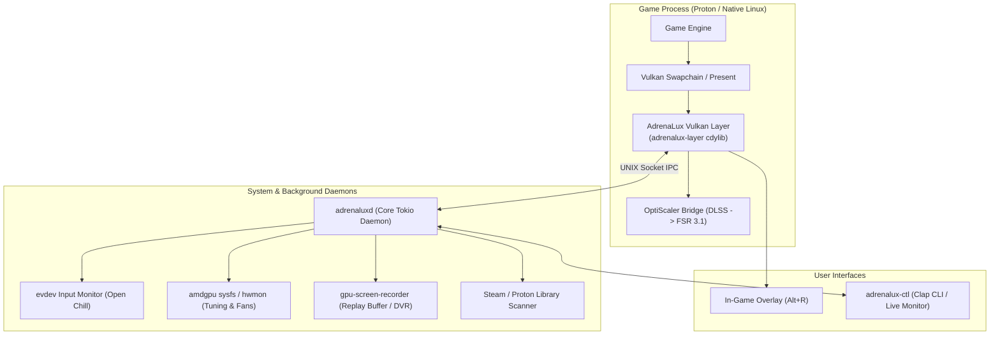

# AdrenaLux ⚡

[](LICENSE)
[](https://www.rust-lang.org/)
[](https://kernel.org)
[]()
[]()

> **The free and open-source gaming overlay and performance suite for Linux** — bringing the best of AMD Adrenalin (Unified In-Game HUD, Open Chill dynamic frame pacing, Instant Replay DVR, Hardware Tuning, and OptiScaler DLSS-to-FSR profiles) to the Linux gaming ecosystem.

---

## 🎯 Vision & Core Features

On Windows, the AMD Adrenalin software suite provides a tightly integrated, all-in-one experience. On Linux, the graphics driver stack (Mesa / RADV / amdgpu) delivers exceptional compute performance, but the user experience is fragmented across disconnected CLI tools and standalone utilities.

**AdrenaLux** is a 100% open-source, modular suite designed to unite these capabilities:
1. **In-Game HUD & Overlay**: Zero-latency Vulkan implicit layer (`Alt+R` / `Alt+Z`) with hardware metrics, instant replay controls, and profile switching.
2. **Open Chill & Boost**: Input-aware dynamic framerate throttling and resolution scaling that slashes power consumption and heat during menus and AFK periods.
3. **OptiScaler & Profile Automation**: Automated DLSS-to-FSR injection, configuration management, and per-game tuning for Steam and Proton titles.
4. **Hardware & DVR Integration**: Seamless integration with `amdgpu` sysfs and `gpu-screen-recorder` for one-click instant replay clips and fan/power control.

---

## 🏗️ Architecture



---

## 🚀 Quick Start & Building

### Prerequisites
* Rust toolchain (1.75+): `cargo`, `rustc`
* Vulkan development headers: `vulkan-headers`
* Kernel input headers: `libevdev`

### Build from Source
```bash
# Clone the repository
git clone https://github.com/thomasbaloyi/adrenalux.git
cd adrenalux

# Build all workspace crates in release mode
cargo build --release

# Run the test suite
cargo test
```

### Running AdrenaLux
```bash
# 1. Start the background performance daemon
./target/release/adrenaluxd

# 2. Check live AMD GPU metrics and Open Chill status
./target/release/adrenalux-ctl status

# 3. Configure Open Chill dynamic frame pacing
./target/release/adrenalux-ctl chill --idle-fps 30 --active-fps 144 --timeout-ms 1500

# 4. Launch the live updating console dashboard
./target/release/adrenalux-ctl monitor
```

---

## 🗺️ Engineering Plan & Milestones

The project is actively developed under a structured, phased roadmap. Detailed specifications, architecture designs, risk mitigations, and testing architectures can be found in:

👉 **[Master Project Plan (PROJECT_PLAN.md)](PROJECT_PLAN.md)**

---

## 🤝 Contributing & Open-Source Community

AdrenaLux is an **open-source community project** licensed under the **GNU General Public License v3.0**. Contributions, issue reports, and pull requests are warmly welcomed!

### Ways to Contribute:
* **Code:** Check the [PROJECT_PLAN.md](PROJECT_PLAN.md) for active milestones (Vulkan swapchain overlay rendering, OptiScaler prefix injection, Wayland compositor hooks).
* **Testing:** Test AdrenaLux across different AMD GPUs (RDNA 1/2/3/4), desktop environments (KDE Wayland, GNOME, Hyprland, Gamescope), and Proton titles.
* **Feature Requests & Feedback:** Open an issue on GitHub to discuss design proposals.

---

## 📜 License

This project is licensed under the **GNU General Public License v3.0 (GPL-3.0)** — see the [LICENSE](LICENSE) file for details.
All software remains free, copyleft, and open for the Linux community.
