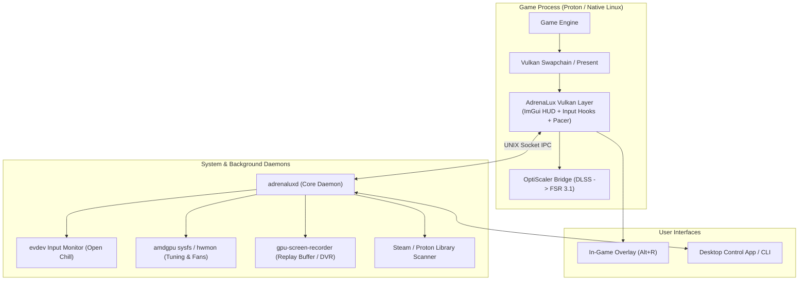

# AdrenaLux ⚡
> The unified open-source gaming overlay and performance suite for Linux — bringing the best of AMD Adrenalin to Linux gaming.

---

## 🎯 Vision

On Windows, the AMD Adrenalin software suite provides a tightly integrated, all-in-one experience: an in-game overlay (`Alt+R`), dynamic frame limiting (Radeon Chill), instant replay recording (ReLive), hardware tuning, and resolution scaling.

On Linux, the graphics driver stack (Mesa / RADV / amdgpu) has incredible raw performance, but the user experience is fragmented across disparate CLI tools, detached GUI apps, and manual configuration scripts.

**AdrenaLux** bridges this gap by unifying these capabilities into a single, cohesive ecosystem:
1. **In-Game HUD & Overlay**: Zero-latency Vulkan implicit layer (`Alt+R` / `Alt+Z`) with hardware metrics, instant replay controls, and profile switching.
2. **Open Chill & Boost**: Input-aware dynamic framerate throttling and resolution scaling that slashes power consumption and heat during menus and AFK periods.
3. **OptiScaler & Profile Automation**: Automated DLSS-to-FSR injection, configuration management, and per-game tuning for Steam and Proton titles.
4. **Hardware & DVR Integration**: Seamless integration with `amdgpu` sysfs and `gpu-screen-recorder` for one-click instant replay clips and fan/power control.

---

## 🗺️ Project Documentation

* **[Comprehensive Project Plan & Architecture](PROJECT_PLAN.md)**: Detailed technical specifications, modular architecture, and multi-month roadmap.

---

## 🏗️ Architecture Overview

---

## 📋 Status & Roadmap

We are currently in **Phase 1: Architecture & Foundation**. See [PROJECT_PLAN.md](PROJECT_PLAN.md) for full phase breakdown, milestones, and task checklists.

---

## 📜 License

GPL-3.0 or MIT (TBD during Phase 1 specification).
